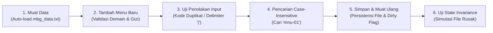

# Sistem Manajemen Program Makan Bergizi Gratis (MBG)
## Modul Praktikum 14 (P14) - Pengujian, Refactoring, dan Finalisasi Proyek

Aplikasi desktop dan konsol interaktif berbasis Java untuk tata kelola operasional Program Makan Bergizi Gratis (MBG) Badan Gizi Nasional Republik Indonesia. Sistem ini mengelola katalog paket menu makanan bergizi, pemantauan batas kecukupan gizi (kalori, protein, karbohidrat), penghitungan estimasi biaya porsi, alokasi stok bahan baku dapur, pelacakan distribusi pengiriman sekolah, hingga mekanisme persistensi berkas berkonsistensi tinggi (*fail-safe file storage*).

---

## 1. Identitas Mahasiswa & Pengembang
- **Nama**        : Mohamad Zaky Bahtiar Arifianto
- **NRP**         : 3125522015
- **Kelas / Prodi**: 2 D3 Teknik Informatika
- **Institusi**    : Politeknik Elektronika Negeri Surabaya (PENS) PSDKU Sumenep
- **Mata Kuliah** : Praktikum Pemrograman Berorientasi Obyek (PBO)
- **Dosen Pengampu**: Nirwana Haidar Hari, S.Pd., M.Kom.

---

## 2. Kebutuhan Sistem & Dependensi (Prerequisites)
- **Sistem Operasi** : Microsoft Windows 10/11 (64-bit), Linux, atau macOS.
- **Java Development Kit (JDK)**: **JDK 17 atau JDK 21 LTS** (Oracle JDK, OpenJDK, Eclipse Temurin).
- **Driver / Library Tambahan**:
  - `lib/mysql-connector-j-8.3.0.jar` (Konektor Database Relasional).
  - JavaFX SDK 21+ (`javafx-base`, `javafx-controls`, `javafx-fxml`, `javafx-graphics`) jika menjalankan antarmuka grafis.
- **Tools Opsional** : VS Code / IntelliJ IDEA / Apache NetBeans / Command Prompt / PowerShell.

---

## 3. Struktur Direktori Proyek

```text
P14_3125522015_Mohamad Zaky Bahtiar/
├── bin/                                  # Bytecode terkompilasi (.class)
├── lib/                                  # Pustaka eksternal (JAR)
│   ├── javafx-base-21.0.2-win.jar
│   ├── javafx-controls-21.0.2-win.jar
│   ├── javafx-fxml-21.0.2-win.jar
│   ├── javafx-graphics-21.0.2-win.jar
│   └── mysql-connector-j-8.3.0.jar
├── src/                                  # Kode sumber Java
│   └── P14_3125522015_MohamadZaky/
│       ├── AppLauncher.java              # Entry point bootstrap antarmuka GUI
│       ├── Main.java                     # Aplikasi konsol & runner 10 skenario uji
│       ├── controller/
│       │   └── MainController.java       # Pengendali GUI JavaFX
│       ├── model/                        # Entitas domain & domain services
│       │   ├── Admin.java
│       │   ├── BahanBaku.java
│       │   ├── DapatDilacak.java         # Interface pelacakan pengiriman
│       │   ├── DetailPengiriman.java
│       │   ├── Driver.java
│       │   ├── Menu.java                 # Entitas Menu dengan penegakan Class Invariant
│       │   ├── PengelolaDistribusi.java
│       │   ├── PengelolaMenu.java        # Domain Service pengelola koleksi & keunikan kode
│       │   ├── Pengguna.java
│       │   ├── Pengiriman.java
│       │   ├── Sekolah.java
│       │   ├── StafDapur.java
│       │   └── StokTidakCukupException.java
│       ├── utils/                        # Data access & file repositories
│       │   ├── DatabaseConnection.java
│       │   ├── MbgFileRepository.java    # File Repository dengan State Invariance Protection
│       │   └── MbgRepository.java
│       └── view/                         # Tampilan visual GUI JavaFX
│           ├── MainView.fxml
│           └── style.css
├── DESIGN.md                             # Arahan desain antarmuka institusional MBG
├── LAPORAN_P14.md                        # Dokumentasi teknis & laporan modul 14
├── mbg_data.txt                          # Berkas penyimpanan data aktif (default)
├── mbg_data_backup.txt                   # Berkas cadangan data baku awal
├── mbg_db.sql                            # Skema basis data SQL
├── run.bat                               # Skrip batch otomatis kompilasi & eksekusi Windows
├── test_execution_log.txt                # Log rekaman eksekusi 10 skenario pengujian
├── 3125522015_Mohamad Zaky Bahtiar Arifianto.docx # Dokumen Laporan P14 (Word)
└── 3125522015_Mohamad Zaky Bahtiar Arifianto.pdf  # Dokumen Laporan P14 (PDF Resmi)
```

---

## 4. Lokasi Berkas Data & Cadangan
- **Berkas Data Operasional**: `mbg_data.txt`
  - Berada langsung di root direktori kerja P14.
  - Memuat data menu aktif yang disinkronisasi saat pengguna memilih opsi `5 (Simpan Data)` atau `6 (Muat Ulang Data)`.
  - Format penyimpanan menggunakan pemisah pipa (`|`):
    `[KodeMenu]|[NamaMenu]|[Kalori]|[Protein]|[Karbohidrat]|[BiayaPorsi]`
- **Berkas Cadangan (Baseline Backup)**: `mbg_data_backup.txt`
  - Berisi rekaman 2 paket makanan baku awal untuk keperluan pemulihan data atau eksekusi pengujian regresi terisolasi.

---

## 5. Cara Kompilasi Program

### Opsi A: Menggunakan Skrip Otomatis Windows (`run.bat`)
Buka terminal / Command Prompt pada direktori `P14_3125522015_Mohamad Zaky Bahtiar`, lalu jalankan:
```cmd
run.bat
```
Skrip ini akan secara otomatis membuat direktori `bin/`, melakukan kompilasi seluruh kode Java, dan langsung menjalankan program.

### Opsi B: Kompilasi Manual Menggunakan `javac`
Jalankan perintah berikut melalui terminal:
```bash
javac -cp "lib\mysql-connector-j-8.3.0.jar" -d "bin" src\P14_3125522015_MohamadZaky\*.java src\P14_3125522015_MohamadZaky\model\*.java src\P14_3125522015_MohamadZaky\utils\*.java
```

---

## 6. Cara Menjalankan Program

### A. Mode Konsol Interaktif (Operasional Pengguna)
```bash
java -cp "bin;lib\mysql-connector-j-8.3.0.jar" P14_3125522015_MohamadZaky.Main
```
Navigasi menu interaktif:
- `1` : Tambah Menu Baru (dengan validasi fail-fast gizi & biaya).
- `2` : Tampilkan Seluruh Katalog Menu.
- `3` : Cari Menu (Pencarian *case-insensitive* berdasarkan kode menu).
- `4` : Hapus Menu dari Koleksi Memori.
- `5` : Simpan Perubahan ke Berkas `mbg_data.txt`.
- `6` : Muat Ulang Data dari Berkas (dilengkapi proteksi *uncommitted changes*).
- `0` : Keluar Aplikasi (dengan konfirmasi pembatalan jika ada perubahan belum disimpan).

### B. Mode Pengujian Otomatis (10 Skenario Uji Modul 14)
Jalankan perintah berikut untuk menguji seluruh 10 skenario secara berurutan dan terisolasi:
```bash
java -cp "bin;lib\mysql-connector-j-8.3.0.jar" P14_3125522015_MohamadZaky.Main --test
```
Atau dapat juga menggunakan flag `--skenario` atau `--auto-test`.

---

## 7. Ringkasan Fitur untuk Demonstrasi Pengujian Dosen (5–7 Menit)

Alur demonstrasi disusun secara runtut sesuai instruksi Modul 14:



### Panduan Langkah Demonstrasi:
1. **Kebutuhan & Pembagian Tanggung Jawab Kelas (Arsitektur SoC & SRP)**:
   - `Main.java`: Lapisan presentasi konsol; mengelola input `Scanner`, navigasi menu yang telah didekomposisi ke *private methods*, dan status *dirty flag* (`adaPerubahan`).
   - `Menu.java`: Kelas domain inti; menegakkan *Class Invariant* (validasi spasi, delimiter pipa `|`, batasan kalori/biaya di constructor & setter final).
   - `PengelolaMenu.java`: Domain service; memusatkan koleksi memori (`List<Menu>`), pencarian *case-insensitive*, dan penegakan keunikan kode menu.
   - `MbgFileRepository.java`: Lapisan I/O berkas; mengimplementasikan teknik *buffer staging* guna menjamin *State Invariance*.
2. **Alur Penggunaan Utama (CRUD & Persistensi Berkas)**:
   - Pilih menu `2` untuk membuktikan 2 data awal termuat secara otomatis (*auto-load*).
   - Pilih menu `1` untuk mendaftarkan menu baru `MNU-03` (*Paket C: Nasi Ikan Gurame Bakar*).
   - Pilih menu `5` untuk menyimpan data permanen ke `mbg_data.txt`.
3. **Penolakan Masukan Tidak Valid (*Fail-Fast Handling*)**:
   - Uji kode duplikat: Masukkan kembali kode `MNU-01` -> Sistem menolak: `Data ditolak: Kode menu 'MNU-01' sudah terdaftar.`
   - Uji delimiter terlarang: Masukkan nama mengandung tanda pipa `Paket D | Ekstra Sambal` -> Sistem menolak: `Data ditolak: Nama menu tidak boleh mengandung karakter pemisah '|' atau baris baru.`
4. **Penyimpanan & Pemuatan Kembali (*Persistence & Auto-load Verification*)**:
   - Keluar dari program (menu `0`), jalankan kembali program, lalu pilih menu `2`. Data menu baru yang telah disimpan tetap tersedia secara konsisten.
5. **Bukti Ketahanan *State Invariance* pada File Rusak**:
   - Jika berkas diubah dengan format kolom yang cacat, pemanggilan pemuatan ulang akan melempar `IOException` secara anggun (*graceful*), dan koleksi objek di memori RAM dijamin tidak terhapus atau rusak.

