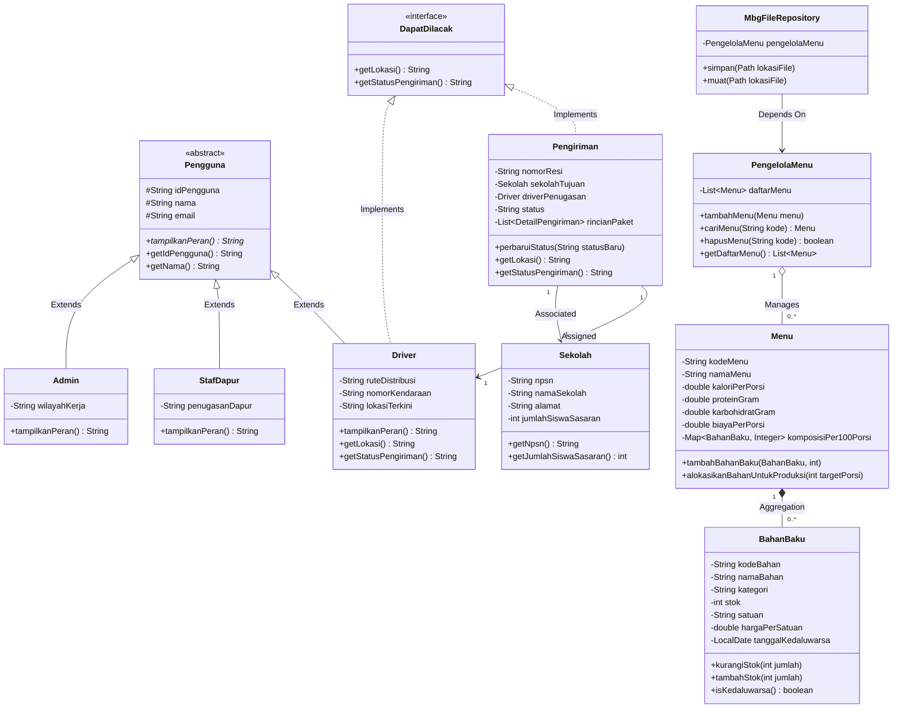

# Sistem Manajemen Program Makan Bergizi Gratis (MBG)

[](https://www.oracle.com/java/)
[](https://openjfx.io/)
[](https://www.mysql.com/)
[](#panduan-kompilasi-dan-eksekusi)
[](https://sumenep.pens.ac.id/)

Sistem perangkat lunak *enterprise desktop* dan konsol interaktif berbasis Java untuk tata kelola operasional Program Makan Bergizi Gratis (MBG) Badan Gizi Nasional Republik Indonesia. Aplikasi ini dirancang untuk unit pelayanan pangan daerah dan dapur sentral guna memastikan pemantauan takaran makronutrisi porsi anak sekolah, pengendalian ketahanan stok bahan baku, pelacakan armada distribusi logistik sekolah, serta persistensi data berkeandalan tinggi (*fail-safe atomic persistence*).

---

## 1. Identitas Proyek & Pengembang

| Atribut | Keterangan Akademik |
| :--- | :--- |
| **Pengembang** | Mohamad Zaky Bahtiar Arifianto |
| **NRP** | 3125522015 |
| **Kelas / Program Studi** | 2 D3 Teknik Informatika |
| **Institusi** | Politeknik Elektronika Negeri Surabaya (PENS) PSDKU Sumenep |
| **Mata Kuliah** | Praktikum Pemrograman Berorientasi Obyek (PBO) |
| **Dosen Pengampu** | Nirwana Haidar Hari, S.Pd., M.Kom. |
| **Tahun Akademik** | 2026/2027 |

---

## 2. Arsitektur Sistem & Diagram Kelas (UML)

Sistem menerapkan prinsip pemisahan tanggung jawab (*Separation of Concerns*) secara ketat ke dalam empat lapisan:
- **Presentation Layer**: `AppLauncher` (JavaFX GUI bootstrap), `MainController` (event dispatcher & visual coordinator), dan `Main` (CLI console runner).
- **Domain Service Layer**: `PengelolaMenu` (manajer katalog & keunikan kode porsi) dan `PengelolaDistribusi` (manajer armada distribusi).
- **Domain Entities**: `Menu`, `BahanBaku`, `Sekolah`, `Pengiriman`, `DetailPengiriman`, serta hierarki `Pengguna` (`Admin`, `StafDapur`, `Driver`).
- **Persistence Layer**: `MbgFileRepository` (penyimpanan flat-file atomik) dan `MbgRepository` / `DatabaseConnection` (jembatan relasional MySQL).



---

## 3. Fitur Kunci Rekayasa Perangkat Lunak

### A. Validasi Fail-Fast & Penegakan Class Invariants
Setiap entitas bisnis (`Menu`, `BahanBaku`, `Sekolah`) melindungi integritas *state* dirinya sendiri (*self-validating*). Atribut dideklarasikan `private`, dan setter memvalidasi input secara ketat:
- **Penolakan Format Rusak**: Setter `setKodeMenu()` dan `setNamaMenu()` menolak string kosong (`trim().isEmpty()`), baris baru (`\n`, `\r`), dan karakter pembatas berkas (`|`) secara seketika saat objek diinstansiasi.
- **Validasi Nilai Fisik**: Kalori, protein, karbohidrat, biaya porsi, dan harga bahan baku dipastikan bernilai positif (`> 0`). Objek dalam *state* cacat mustahil tercipta di heap RAM.

### B. Two-Phase Atomic Stock Allocation & Custom Exception
Method `alokasikanBahanUntukProduksi(int targetPorsi)` pada `Menu.java` menerapkan validasi dua fase:
1. **Fase Verifikasi**: Memeriksa seluruh bahan baku dalam `komposisiPer100Porsi`. Jika ada bahan yang kedaluwarsa (`isKedaluwarsa()`) atau stok tidak mencukupi, melempar `StokTidakCukupException` khusus domain yang memuat detail bahan, stok tersedia, dan kuantitas yang diminta.
2. **Fase Eksekusi**: Pemotongan stok bahan baku hanya dijalankan jika 100% bahan dinyatakan lolos pada Fase 1, mencegah terjadinya pemotongan stok parsial.

### C. Atomic Staging File I/O & Jaminan State Invariance
Mekanisme serialisasi dan deserialisasi pada `MbgFileRepository.java` menjamin *Fail-Safe State Invariance*:
- Pembacaan berkas flat-file (`mbg_data.txt`) dilakukan ke dalam *staging collection* lokal (`List<Menu> hasilSementara` dan `Set<String> kodeTerbaca`).
- Jika berkas eksternal mengalami kerusakan format baris, kegagalan parsing tipe data, atau duplikasi kode, eksepsi `IOException` dilempar keluar sebelum koleksi aktif dimodifikasi. Koleksi memori aktif dijamin tetap utuh 100% tanpa risiko kehilangan data.

### D. Dirty Flag State Tracking & Unsaved Changes Guard
Pada siklus hidup aplikasi konsol CLI (`Main.java`):
- Variabel state `boolean adaPerubahan` mendeteksi mutasi aktif di memori secara *real-time* (`[Semua perubahan tersimpan]` vs `[Ada perubahan belum disimpan!]`).
- Dialog konfirmasi keluar (`"Perubahan belum disimpan. Abaikan? Ketik YA: "`) melindungi operator dari kehilangan data akibat keluar atau memuat ulang secara tidak sengaja.

### E. Dual Interface: Desktop GUI JavaFX & Konsol CLI
Aplikasi mendukung dua titik masuk operasional:
1. **Desktop GUI (`AppLauncher`)**: Antarmuka modern JavaFX berbasis FXML & CSS korporat institusional (Dashboard metrik, Inventaris stok, Katalog menu & gizi, Pelacakan logistik pengiriman, dan Master data sekolah).
2. **Konsol Interaktif (`Main`)**: Mode konsol efisien untuk pemrosesan cepat di lingkungan terminal serta runner uji regresi otomatis (`--test`).

---

## 4. Matriks Evolusi Proyek (Modul 1 s.d. Modul 15)

| Modul | Topik Rekayasa | Implementasi Konkret pada Sistem MBG |
| :---: | :--- | :--- |
| **P01** | *Pengenalan Sintaks & Setup* | Struktur program Java dasar, tata kelola compiler, dan output teks konsol MBG. |
| **P02** | *Tipe Data & Operator* | Kalkulasi formula makronutrisi gizi dasar (kalori, gramasi protein, dan estimasi biaya). |
| **P03** | *Class & Object Instantiation* | Pemodelan entitas dasar `Menu` dan `BahanBaku` sebagai representasi logistik dapur. |
| **P04** | *Methods & Overloading* | Implementasi kalkulator konversi bahan baku per takaran 100 porsi penerima manfaat. |
| **P05** | *Encapsulation & Access Modifiers* | Proteksi atribut private dan pembatasan mutasi via setter/getter berpenjaga. |
| **P06** | *Inheritance (Pewarisan)* | Perancangan hierarki personel unit pelayanan: `Pengguna` diturunkan ke `Admin`, `StafDapur`, dan `Driver`. |
| **P07** | *Polymorphism & Dynamic Binding* | Override method polimorfik `tampilkanPeran()` sesuai hak akses dan tanggung jawab operasional aktor. |
| **P08** | *Abstract Class & Interface* | Pembentukan kontrak abstraksi pelacakan armada logistik real-time via `DapatDilacak`. |
| **P09** | *Database Connectivity (JDBC)* | Integrasi jembatan koneksi basis data relasional MySQL XAMPP (`mbg_db.sql`) via `DatabaseConnection`. |
| **P10** | *Exception Handling & State Guard* | Pembuatan `StokTidakCukupException`, validasi fail-fast pada konstruktor, dan pengujian alokasi stok 2-fase. |
| **P11** | *Collections & Generics* | Migrasi dari array primitif ke `ArrayList<Menu>` via `PengelolaMenu`, pencegahan kode duplikat, dan `unmodifiableList`. |
| **P12** | *File I/O & Persistence* | Implementasi `MbgFileRepository` berbasis flat-file berpemisah pipa (`\|`) dengan proteksi *State Invariance*. |
| **P13** | *Interactive CLI Integration* | Penggabungan seluruh fitur ke dalam loop menu interaktif berbasis Scanner, eliminasi newline residue, dan *dirty flag*. |
| **P14** | *Refactoring & Regression Suite* | Pembersihan kode (*Extract Method*), penegakan *Class Invariant* (BUG-01, 02, 03), dan suite 10 uji regresi otomatis. |
| **P15** | *Finalisasi, GUI & Demonstrasi* | Perbaikan `AppLauncher` JavaFX GUI, naskah alur demonstrasi 7 menit, presentasi eksekutif 5 slide, dan rilis final. |

---

## 5. Struktur Direktori Proyek

```text
.
├── bin/                                  # Bytecode Java terkompilasi (.class)
│   └── P15_3125522015_MohamadZaky/
│       ├── controller/MainController.class
│       ├── model/*.class
│       ├── utils/*.class
│       ├── view/MainView.fxml, style.css
│       ├── AppLauncher.class
│       └── Main.class
├── lib/                                  # Dependensi pustaka eksternal (JAR)
│   ├── javafx-base-21.0.2-win.jar
│   ├── javafx-controls-21.0.2-win.jar
│   ├── javafx-fxml-21.0.2-win.jar
│   ├── javafx-graphics-21.0.2-win.jar
│   └── mysql-connector-j-8.3.0.jar
├── Screenshot/                           # Bukti visual pengujian, terminal log, & diagram UML
├── src/                                  # Kode sumber Java murni
│   └── P15_3125522015_MohamadZaky/
│       ├── controller/MainController.java
│       ├── model/*.java
│       ├── utils/*.java
│       ├── view/MainView.fxml, style.css
│       ├── AppLauncher.java              # JavaFX GUI Launcher Entry Point
│       └── Main.java                     # CLI Console & Test Runner Entry Point
├── logombg.jpeg                          # Aset visual resmi Badan Gizi Nasional RI
├── mbg_data.txt                          # Berkas flat-file data aktif
├── mbg_data_backup.txt                   # Berkas data awal cadangan (steril dari PII)
├── mbg_db.sql                            # Skema basis data relasional MySQL
├── run.bat                               # Skrip batch kompilasi & eksekusi CLI
├── run-gui.bat                           # Skrip batch kompilasi & eksekusi Desktop JavaFX GUI
├── Presentasi_Demonstrasi_P15.pptx        # Slide presentasi eksekutif 5 slide Widescreen 16:9
├── laporan_akhir_final.docx              # Dokumen master Word laporan akhir
├── laporan_akhir_final.pdf               # Dokumen master PDF laporan akhir
└── README.md                             # Dokumentasi repositori GitHub
```

---

## 6. Panduan Kompilasi dan Eksekusi

### A. Kebutuhan Sistem (Prerequisites)
- **Java Development Kit (JDK)**: JDK 17, JDK 21 LTS, atau JDK 26+ (Oracle JDK / OpenJDK / Eclipse Temurin).
- **Sistem Operasi**: Windows 10/11 (64-bit), Linux, atau macOS.
- **Basis Data (Opsional)**: MySQL / XAMPP (jika ingin mengaktifkan sinkronisasi basis data relasional `mbg_db`).

---

### B. Menjalankan Desktop GUI JavaFX (Mode Antarmuka Grafis)

#### Opsi 1: Menggunakan Skrip Otomatis Windows
Cukup jalankan berkas batch berikut dari Command Prompt atau PowerShell:
```cmd
run-gui.bat
```
Atau melalui parameter pada `run.bat`:
```cmd
run.bat --gui
```

#### Opsi 2: Menjalankan Manual via Terminal
1. **Kompilasi Seluruh Kode Sumber & Sinkronisasi Resource Tampilan**:
   ```cmd
   if not exist "bin\P15_3125522015_MohamadZaky\view" mkdir "bin\P15_3125522015_MohamadZaky\view"
   copy /Y "src\P15_3125522015_MohamadZaky\view\*" "bin\P15_3125522015_MohamadZaky\view\" >nul

   javac --module-path "lib" --add-modules javafx.controls,javafx.fxml,javafx.graphics,javafx.base -cp "lib\mysql-connector-j-8.3.0.jar" -d "bin" src\P15_3125522015_MohamadZaky\*.java src\P15_3125522015_MohamadZaky\model\*.java src\P15_3125522015_MohamadZaky\utils\*.java src\P15_3125522015_MohamadZaky\controller\*.java
   ```

2. **Eksekusi Aplikasi JavaFX Desktop GUI**:
   ```cmd
   java --enable-native-access=javafx.graphics --module-path "lib" --add-modules javafx.controls,javafx.fxml,javafx.graphics,javafx.base -cp "bin;lib\mysql-connector-j-8.3.0.jar" P15_3125522015_MohamadZaky.AppLauncher
   ```

---

### C. Menjalankan Konsol Interaktif CLI & Uji Regresi Otomatis

#### 1. Mode Konsol Interaktif Menu MBG:
```cmd
java -cp "bin;lib\mysql-connector-j-8.3.0.jar" P15_3125522015_MohamadZaky.Main
```

#### 2. Mode Runner Uji Regresi Otomatis (10 Skenario Kritis):
Untuk memverifikasi keandalan sistem secara instan dengan hasil kelulusan 100%:
```cmd
java -cp "bin;lib\mysql-connector-j-8.3.0.jar" P15_3125522015_MohamadZaky.Main --test
```

---

## 7. Lisensi & Hak Cipta
Hak cipta proyek perangkat lunak ini dimiliki oleh **Mohamad Zaky Bahtiar Arifianto (NRP: 3125522015)** sebagai bagian dari pemenuhan evaluasi akhir mata kuliah Praktikum Pemrograman Berorientasi Obyek, Program Studi D3 Teknik Informatika, PENS PSDKU Sumenep.
